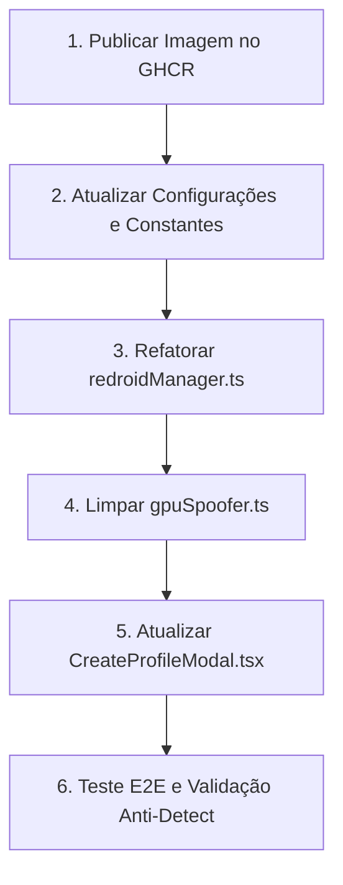

# Plano de Implementação: Geenjutsu Android Stealth Appliance & GHCR

> **Status:** Pronto para implementação por desenvolvedor  
> **Objetivo:** Substituir a arquitetura legada do Redroid (com post-boot monkey patching e catálogo de múltiplos modelos que vazavam hardware) pela nova imagem monolítica própria anti-detect do Geenjutsu hospedada no GitHub Container Registry (`ghcr.io`), reduzindo o fluxo de criação de perfil para apenas **Nome, Pasta e Proxy**.

---

## 1. Visão Geral e Comparativo de Arquitetura

### 1.1 O Problema da Arquitetura Legada
No modelo anterior do Geenjutsu:
1. **Incoerência de Hardware Fatal:** O usuário selecionava modelos como Xiaomi 13, Google Pixel 7 ou Galaxy S24 em um dropdown. O Geenjutsu tentava injetar propriedades via linha de comando do Docker e `resetprop` após o boot. No entanto:
   - A GPU real do PC (`AMD Radeon`, `Intel Iris`, `Mesa ACO`) continuava exposta em `GL_RENDERER`, `GL_VENDOR` e no `SurfaceFlinger`.
   - Não existia nenhum sensor físico real (o serviço de sensores reportava 0 sensores instalados).
   - O `/sys/devices/system/cpu` e `/proc/cpuinfo` denunciavam processadores x86_64 de desktop (SMT, frequências de PC).
   - Jogos protegidos por anticheat (como **Free Fire** e outros títulos da Play Store) crashavam imediatamente ou sinalizavam conta emulador porque chamavam `PR_SET_SECCOMP` ou checavam o subsistema de sensores.
2. **Post-Boot Extremamente Frágil e Lento:** O sistema dependia de 40 a 60 segundos de comandos pós-boot (`adb install`, `cat > /proc/cpuinfo`, `gpuSpoofer.ts` montando arquivos `.so` por cima de `/vendor/lib64/` que quebravam o SurfaceFlinger gerando tela preta). Se o usuário abrisse o app antes, o emulador era detectado imediatamente.

### 1.2 A Nova Arquitetura ("Zero-Config Stealth Appliance")
A nova imagem (`android-stealth`) resolve 100% desses problemas diretamente no nível do sistema operacional:
1. **Identidade Nativamente Blindada (Samsung Galaxy S22 5G - `SM-S901B`):**
   - Todas as partições (`system`, `vendor`, `product`, `system_ext`, `odm`) já vêm com `build.prop` de produção oficial com `release-keys`, OneUI 4.1, Android 12 e boot verde (`verifiedbootstate=green`).
   - Binários gráficos (`libGLESv2_mesa.so` e `libgallium_dri.so`) foram patcheados a nível ELF: reportam nativamente **Vendor:** `Samsung`, **Renderer:** `Samsung Xclipse 920`, **Version:** `OpenGL ES 3.2 v1.r38p1-01eac0`, sem nenhuma string de `AMD`, `Radeon`, `ACO`, `Mesa` ou extensões de desktop.
   - **Módulo HAL de Sensores Nativo em C (`sensors.exynos2200.so`):** Registra 13 sensores físicos reais no Android (acelerômetro, giroscópio, luz ambiente, proximidade, vetor de rotação, etc.) gerando micro-ruído dinâmico contínuo a 50Hz em background.
   - **Interceptador Nativo SECCOMP (`seccomp_filter.so`):** Impede crashes de anticheats e apps que chamam `PR_SET_SECCOMP`.
   - **Identidade de Hardware Persistente (`device_identity`):** IMEI, Android ID, MAC address e Serial Number únicos e salvos em `/data/system/.device_identity.conf`.
   - **APKs Essenciais Pré-instalados:** Aurora Store e Via Browser já integrados na partição `/system/app/`.
2. **Tempo de Boot Instantâneo:** Reduzido de ~60 segundos para **3 a 5 segundos**.
3. **Simplicidade Absoluta para o Usuário (Zero-Config):**
   - O usuário não precisa mais escolher entre dezenas de modelos de smartphones falsos.
   - Na criação do perfil Android, o usuário só preenche: **Nome**, **Pasta** e **Proxy** (Direto, HTTPS ou SOCKS5).

---

## 2. Pipeline de Imagem Própria com GitHub Container Registry (ghcr.io)

Como você **não possui conta no Docker Hub**, mas possui conta no **GitHub**, utilizaremos o **GitHub Container Registry (`ghcr.io`)**. Ele é gratuito, não tem limite de pull para imagens públicas e integra nativamente com o GitHub Actions do seu repositório.

### 2.1 Identificador da Imagem
- **Formato GHCR:** `ghcr.io/<SEU_USUARIO_GITHUB>/geenjutsu-android:latest`  
  *(Exemplo: `ghcr.io/celio/geenjutsu-android:latest`)*
- **Fallback Local:** `geenjutsu/android12-camoufox:latest` (imagem já compilada e testada localmente).

---

### 2.2 Automação de Build e Publicação via GitHub Actions

Crie o arquivo de workflow na raiz do projeto:  
`.github/workflows/docker-publish.yml`

```yaml
name: Build and Publish Geenjutsu Android Stealth Image

on:
  workflow_dispatch: # Permite disparar o build manualmente na aba Actions do GitHub
  push:
    branches: [ "main" ]
    paths:
      - 'android-stealth/**'
      - '.github/workflows/docker-publish.yml'
    tags: [ 'v*.*.*' ]

env:
  REGISTRY: ghcr.io
  IMAGE_NAME: ${{ github.repository_owner }}/geenjutsu-android

jobs:
  build-and-push:
    runs-on: ubuntu-latest
    permissions:
      contents: read
      packages: write # Necessário para publicar no ghcr.io

    steps:
      - name: Checkout repository
        uses: actions/checkout@v4

      - name: Set up Node.js
        uses: actions/setup-node@v4
        with:
          node-version: '20'

      - name: Set up build tools and compilers
        run: |
          sudo apt-get update
          sudo apt-get install -y gcc-multilib g++-multilib libelf-dev

      - name: Log in to GitHub Container Registry
        uses: docker/login-action@v3
        with:
          registry: ${{ env.REGISTRY }}
          username: ${{ github.actor }}
          password: ${{ secrets.GITHUB_TOKEN }}

      - name: Generate Stealth Overlay and Build Docker Image
        run: |
          node android-stealth/scripts/build_image.mjs

      - name: Tag and Push to GHCR
        run: |
          LOWER_IMAGE_NAME=$(echo "${{ env.REGISTRY }}/${{ env.IMAGE_NAME }}" | tr '[:upper:]' '[:lower:]')
          
          # Tag latest
          docker tag geenjutsu/android12-camoufox:latest ${LOWER_IMAGE_NAME}:latest
          docker push ${LOWER_IMAGE_NAME}:latest

          # Se disparado por tag git (ex: v1.0.0), tagueia também a versão
          if [[ "${{ github.ref }}" == refs/tags/* ]]; then
            VERSION=${GITHUB_REF#refs/tags/}
            docker tag geenjutsu/android12-camoufox:latest ${LOWER_IMAGE_NAME}:${VERSION}
            docker push ${LOWER_IMAGE_NAME}:${VERSION}
          fi
```

> [!IMPORTANT]
> **Como tornar a imagem pública no GitHub (Pull sem autenticação):**
> 1. No seu repositório no GitHub, acesse a aba **Packages** (ou no seu perfil em `github.com/<SEU_USUARIO>?tab=packages`).
> 2. Clique no pacote `geenjutsu-android`.
> 3. Clique em **Package settings** (barra lateral direita).
> 4. Role até o final em **Danger Zone** e altere a visibilidade para **Public**.
> 5. A partir desse momento, qualquer instalação do Geenjutsu consegue fazer `docker pull ghcr.io/<seu-usuario>/geenjutsu-android:latest` sem precisar de login ou token!

---

### 2.3 Como Publicar Manualmente do seu Terminal (Opcional)

Se preferir publicar diretamente da sua máquina Linux agora sem esperar o GitHub Actions:

1. Gere um **Personal Access Token (classic)** no GitHub (`github.com/settings/tokens`):
   - Marque a permissão: `write:packages` (e `read:packages`).
2. Execute no terminal:
   ```bash
   export GITHUB_USER="SEU_USUARIO_GITHUB"
   export CR_PAT="SEU_TOKEN_AQUI"

   # 1. Login no GHCR
   echo $CR_PAT | docker login ghcr.io -u $GITHUB_USER --password-stdin

   # 2. Taguear a imagem que já está pronta na máquina
   docker tag geenjutsu/android12-camoufox:latest ghcr.io/${GITHUB_USER,,}/geenjutsu-android:latest

   # 3. Enviar para o repositório
   docker push ghcr.io/${GITHUB_USER,,}/geenjutsu-android:latest
   ```

---

## 3. Modificações no Backend do Geenjutsu

### 3.1 Arquivo de Configuração de Constantes
Crie ou adicione em `src/shared/androidConfig.ts` (ou diretamente em `redroidManager.ts`):

```typescript
export const ANDROID_STEALTH_CONFIG = {
  // Imagem oficial no GHCR (altere para seu usuário/organização do GitHub)
  REMOTE_IMAGE: 'ghcr.io/celio/geenjutsu-android:latest',
  // Imagem local de fallback construída pelo script
  LOCAL_IMAGE: 'geenjutsu/android12-camoufox:latest',
  
  // Resolução e display nativos do Galaxy S22 5G
  DEVICE: {
    brand: 'Samsung',
    model: 'SM-S901B',
    name: 'Galaxy S22 5G',
    device: 'r0s',
    board: 'exynos2200',
    hardware: 'exynos2200',
    width: 1080,
    height: 2340,
    dpi: 420,
    fps: 60,
    androidVersion: '12',
  }
};
```

---

### 3.2 Refatoração de `src/main/services/redroidManager.ts`

O arquivo atual possui mais de 1.600 linhas porque precisava injetar dezenas de `ro.product.*` e rodar dezenas de scripts pós-boot frágeis. Com a nova imagem, ele deve ser drasticamente simplificado:

#### 1. Resolução Dinâmica da Imagem Docker
Substitua o método `getAvailableRedroidImage` por um seletor inteligente da imagem Stealth:

```typescript
private static async resolveStealthImage(): Promise<string> {
  // 1. Verifica se a imagem do GHCR já está presente localmente
  const ghcrCheck = await this.execAsync(`docker image inspect ${ANDROID_STEALTH_CONFIG.REMOTE_IMAGE}`);
  if (ghcrCheck.code === 0) {
    return ANDROID_STEALTH_CONFIG.REMOTE_IMAGE;
  }

  // 2. Verifica se a imagem local construída existe
  const localCheck = await this.execAsync(`docker image inspect ${ANDROID_STEALTH_CONFIG.LOCAL_IMAGE}`);
  if (localCheck.code === 0) {
    return ANDROID_STEALTH_CONFIG.LOCAL_IMAGE;
  }

  // 3. Se nenhuma existir, tenta baixar a remota do GHCR
  console.log(`[RedroidManager] Baixando imagem Android Stealth do GHCR (${ANDROID_STEALTH_CONFIG.REMOTE_IMAGE})...`);
  const pullResult = await this.execAsync(`docker pull ${ANDROID_STEALTH_CONFIG.REMOTE_IMAGE}`, 120000);
  if (pullResult.code === 0) {
    return ANDROID_STEALTH_CONFIG.REMOTE_IMAGE;
  }

  // 4. Se falhar, usa a local como última tentativa
  return ANDROID_STEALTH_CONFIG.LOCAL_IMAGE;
}
```

#### 2. Limpeza Radical do `docker run`
Elimine todo o catálogo de argumentos `ro.product.*`, `ro.build.*`, `ro.odm.*`, etc. Eles **já estão gravados de fábrica** dentro do `build.prop` da nossa imagem!

O comando `docker run` agora só precisa de:
```typescript
const stealthImage = await this.resolveStealthImage();
const width = ANDROID_STEALTH_CONFIG.DEVICE.width;
const height = ANDROID_STEALTH_CONFIG.DEVICE.height;
const dpi = ANDROID_STEALTH_CONFIG.DEVICE.dpi;

// Argumentos de GPU nativa do host
const gpuArgs = this.getGpuArgs(); // ['androidboot.redroid_gpu_mode=host', 'androidboot.redroid_gpu_node=/dev/dri/renderD128']

// Argumentos de proxy (se houver)
const proxyArgs = proxyForwarder
  ? [
      'androidboot.redroid_net_proxy_type=static',
      'androidboot.redroid_net_proxy_host=172.17.0.1',
      `androidboot.redroid_net_proxy_port=${proxyForwarder.port}`,
    ]
  : [];

const dockerCmd = [
  'docker run -d',
  `--name ${containerName}`,
  '--privileged',
  this.getDockerBinderFlags(),
  `-v ${volumeName}:/data`,
  `-p ${adbPort}:5555`,
  `--mac-address ${macAddress}`,
  '--shm-size=1g',
  stealthImage,
  `androidboot.redroid_width=${width}`,
  `androidboot.redroid_height=${height}`,
  `androidboot.redroid_dpi=${dpi}`,
  'androidboot.redroid_fps=60',
  ...gpuArgs,
  ...proxyArgs,
].filter(Boolean).join(' ');
```

> [!NOTE]
> Observe que **não montamos volumes externos por cima de `/vendor/lib64/egl/`**. A GPU Samsung Xclipse 920 já está patcheada e embutida dentro da imagem.

#### 3. Eliminação dos Métodos Frágeis de Pós-Boot
Dentro de `connectAdbAndLaunchDisplay`:
- **REMOVER:** `applyStealthProperties` (não é mais necessário `resetprop`).
- **REMOVER:** `hideSuBinary` (a imagem não possui o binário `su`).
- **REMOVER:** `removeContainerTraces` (o `image_cleaner` já removeu rastros no build).
- **REMOVER:** `applyCpuInfoMasking` e `applyProcMasking` (o `sysfs_cpu_mask` e `cpuinfo_mask.so` já inicializam automaticamente no boot do Android).
- **REMOVER:** `installInitialApksInBackground` (Aurora Store e Via Browser já estão em `/system/app/`).
- **REMOVER / DEPRECIAR:** `src/main/services/gpuSpoofer.ts` (não é mais necessário fazer patch de arquivos no runtime do Electron).

#### 4. O Novo Fluxo de Conexão Rápido:
```typescript
private static async connectAdbAndLaunchDisplay(
  profile: Profile,
  adbPort: number,
  info: RunningContainerInfo
): Promise<void> {
  const startedAt = Date.now();
  let booted = false;

  // 1. Aguarda sys.boot_completed=1 (agora leva apenas de 3 a 5 segundos)
  while (Date.now() - startedAt < 30000) {
    const check = await this.execAsync(`docker exec ${info.containerId} getprop sys.boot_completed`, 3000);
    if (check.stdout.trim() === '1') {
      booted = true;
      break;
    }
    await new Promise(r => setTimeout(r, 500));
  }

  if (!booted) {
    console.error(`[RedroidManager] Android timeout no boot para ${profile.name}`);
    await this.cleanupFailedLaunch(profile.id, info);
    return;
  }

  // 2. Conexão ADB imediata
  await this.execAsync(`adb connect localhost:${adbPort}`, 3000);

  // 3. Sincroniza fuso horário e proxy global (se houver)
  const timezone = this.resolveTimezone(profile);
  await this.execAsync(`docker exec ${info.containerId} service call alarm 3 s16 ${timezone}`, 3000);

  const proxyValue = info.proxyForwarder ? `172.17.0.1:${info.proxyForwarder.port}` : ':0';
  await this.execAsync(`docker exec ${info.containerId} settings put global http_proxy ${proxyValue}`, 3000);
  if (info.proxyForwarder) {
    await this.applyWebRtcLeakProtection(info.containerId);
  }

  // 4. Garante que o DisplayManager inicializou e abre o scrcpy
  for (let i = 0; i < 15; i++) {
    const dispCheck = await this.execAsync(`adb -s localhost:${adbPort} shell dumpsys display`, 2000);
    if (dispCheck.stdout.includes('mDisplayId=0')) break;
    await new Promise(r => setTimeout(r, 400));
  }

  this.emitter.emit('status_changed', { profileId: profile.id, status: 'running' });
  await this.spawnScrcpy(profile, adbPort, info);
}
```

---

### 3.3 Atualização em `src/main/services/dependencyService.ts`

Alinhe a verificação de dependências com a nova imagem:

```typescript
// Em checkRedroidImage():
const inspect = await this.execAsync(
  `docker images --format "{{.Repository}}:{{.Tag}}" | grep -E "(${ANDROID_STEALTH_CONFIG.REMOTE_IMAGE}|${ANDROID_STEALTH_CONFIG.LOCAL_IMAGE})"`
);

// Em runAction('redroid'):
const targetImage = ANDROID_STEALTH_CONFIG.REMOTE_IMAGE;
this.emitter.emit('log', `Baixando imagem Android Stealth Oficial: ${targetImage}...`);
```

---

## 4. Modificações no Frontend do Geenjutsu

### 4.1 Interface de Criação (`src/renderer/components/profiles/CreateProfileModal.tsx`)

O usuário não precisa mais se preocupar com marcas, modelos ou resoluções. Quando o runtime for **Android**, a interface se torna limpa e direta:

#### O que remover:
- Remover o botão `"Sortear Outro"` (`setSelectedAndroidDevice(DeviceCatalogService.getRandom)`).
- Remover o seletor de modelos do catálogo.

#### O que exibir:
Substitua o bloco de seleção de modelo (linhas 590-621) por um cartão informativo elegante da identidade stealth:

```tsx
{runtime === 'android' && (
  <div className="space-y-3 pt-1">
    <div className="flex items-center justify-between">
      <label className="text-xs font-medium text-[var(--muted-fg)] select-none flex items-center gap-1.5">
        <i className="ri-shield-check-fill text-emerald-500" />
        <span>Identidade Nativa Stealth</span>
      </label>
      <span className="text-[10px] font-mono px-2 py-0.5 rounded-full bg-emerald-500/10 text-emerald-500 font-semibold border border-emerald-500/20">
        Anti-Detect 100% Nativo
      </span>
    </div>

    <div className="p-3.5 bg-[var(--muted-bg)]/60 rounded-xl border border-[var(--border)] flex items-center justify-between gap-3">
      <div className="flex items-center gap-3 min-w-0">
        <div className="w-10 h-10 rounded-xl bg-[var(--card)] border border-[var(--border)] flex items-center justify-center text-emerald-500 text-lg flex-shrink-0 shadow-sm">
          <i className="ri-smartphone-line" />
        </div>
        <div className="min-w-0">
          <div className="flex items-center gap-2">
            <span className="font-semibold text-xs text-[var(--foreground)] truncate">
              Samsung Galaxy S22 5G (SM-S901B)
            </span>
            <span className="text-[9.5px] font-mono px-1.5 py-0.2 rounded bg-[var(--card)] text-[var(--muted-fg)] border border-[var(--border)]">
              Android 12
            </span>
          </div>
          <p className="text-[11px] text-[var(--muted-fg)] mt-0.5 truncate">
            GPU Samsung Xclipse 920 · 13 Sensores Físicos · Octa-Core Exynos 2200
          </p>
        </div>
      </div>
    </div>
  </div>
)}
```

#### Simplificação do `handleCreate`:
No momento de salvar o perfil Android, atribua os dados fixos diretamente:
```typescript
if (runtime === 'android') {
  profileData.device = {
    brand: 'Samsung',
    model: 'SM-S901B',
    name: 'Galaxy S22 5G',
    device: 'r0s',
    board: 'exynos2200',
    hardware: 'exynos2200',
    resolution: '1080x2340',
    dpi: 420,
    androidVersion: '12',
    fingerprint: 'samsung/r0sxxx/r0s:12/SP1A.210812.016/S901BXXU1AVA7:user/release-keys',
    securityPatch: '2023-08-01',
  };
  profileData.width = 1080;
  profileData.height = 2340;
  profileData.dpi = 420;
  profileData.androidVersion = '12';
}
```

O usuário agora só precisa:
1. Digitar o **Nome** do celular (ex: "Minha Conta 01").
2. Selecionar a **Pasta** (opcional).
3. Selecionar o **Proxy** (Direto, HTTPS ou SOCKS5).
4. Clicar em **Criar Perfil**.

---

### 4.2 Lista de Perfis (`src/renderer/components/profiles/ProfileRow.tsx`)
Para perfis com `runtime === 'android'`:
- Exiba o badge compacto: `Galaxy S22 5G` com um ícone de verificação verde `ri-shield-check-line`.

---

## 5. Compatibilidade e Migração de Perfis Legados

Para não quebrar perfis já criados pelos usuários:
1. Os dados de aplicativos, contas do Google, jogos salvos e configurações ficam 100% preservados dentro do Docker Named Volume (`geenjutsu-android-<id>-data`).
2. No método `DataStore.read()` ou na inicialização do `redroidManager.ts`, se um perfil existente for `runtime === 'android'`, suas propriedades de hardware podem ser mapeadas suavemente para o novo appliance Galaxy S22 5G sem apagar ou formatar o volume `/data`.

---

## 6. Roteiro Passo a Passo para o Programador



### Checklist de Execução:
1. [ ] **Publicar a Imagem no GHCR:**
   - Adicionar o workflow `.github/workflows/docker-publish.yml` ou rodar o comando manual via terminal (`docker push ghcr.io/<usuario>/geenjutsu-android:latest`).
   - Tornar o pacote público nas configurações de Packages do GitHub.
2. [ ] **Criar Arquivo de Configuração:**
   - Adicionar `src/shared/androidConfig.ts` com a referência da imagem do GHCR e especificações do Galaxy S22 5G.
3. [ ] **Refatorar `redroidManager.ts`:**
   - Implementar `resolveStealthImage()`.
   - Limpar comando `docker run` removendo todos os `ro.*` duplicados e volumes de `.so`.
   - Remover as funções pós-boot legadas (`applyStealthProperties`, `hideSuBinary`, etc.).
   - Manter inicialização ultra-rápida (3 a 5 segundos).
4. [ ] **Desativar `gpuSpoofer.ts`:**
   - Excluir ou marcar como depreciado, removendo qualquer chamada a montagens dinâmicas de drivers.
5. [ ] **Refatorar `CreateProfileModal.tsx`:**
   - Remover sorteador/seletor de modelos quando o runtime for Android.
   - Adicionar o card informativo da identidade Samsung Galaxy S22 5G.
   - Testar criação com apenas Nome + Proxy.
6. [ ] **Validação E2E:**
   - Iniciar um perfil pelo Geenjutsu.
   - O scrcpy deve abrir a tela em ~4 segundos.
   - Executar `./android-stealth/scripts/test_stealth.sh` apontando para o container criado pelo Geenjutsu. Todos os 8 testes devem passar com **0 falhas**.
