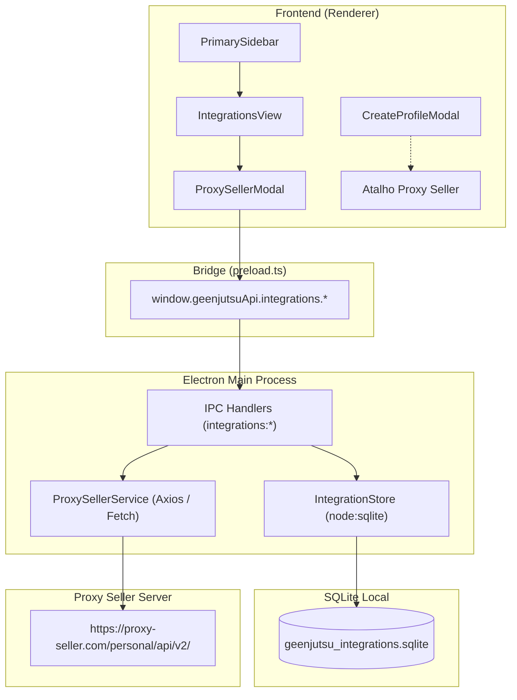

# Especificação Técnica e Guia de Implementação: Módulo de Integrações & Proxy Seller no Geenjutsu

> **Documento de Arquitetura, UI/UX e APIs para Implementação Direta**  
> **Status:** Pronto para Desenvolvimento  
> **Target:** Geenjutsu Multilogin Engine (Electron + React + TypeScript + SQLite)

---

## 1. Visão Geral e Estratégia de Negócio

### 1.1 Objetivo do Módulo
Permitir que usuários do **Geenjutsu** gerenciem e adquiram proxies diretamente de dentro da aplicação via API, transformando o app em uma central de compra e distribuição de proxies ("Proxy Seller Interno"). O usuário não precisará mais abrir o navegador, logar no painel externo, copiar credenciais e colar manualmente campo por campo.

### 1.2 Estratégia de Afiliado & Monetização
* **Link de Afiliado Principal:**  
  `https://proxy-seller.com/?partner=02IEM6EL37OSRR`
* **Pontos de Inserção do Link:**
  1. **Banner de Cadastro (1 clique):** *"Não tem conta? [Cadastre-se no Proxy Seller](https://proxy-seller.com/?partner=02IEM6EL37OSRR)"* (abre no navegador padrão via `openExternal`).
  2. **Botão de Recarga / Depósito:** *"Recarregar Saldo / Depositar"* -> redireciona para a tela de faturamento preservando o parceiro:  
     `https://proxy-seller.com/personal/balance?partner=02IEM6EL37OSRR`.
  3. **Comissão Vitalícia:** Todas as compras de pacotes e proxies feitas por usuários cadastrados geram comissão recorrente.

### 1.3 Segmentação Didática de Proxies (Educação do Usuário)
O app deve deixar cristalina a recomendação de uso para evitar que o usuário tome checkpoints nas plataformas:
1. **Proxy Residencial (Cobrança por GB / Tráfego):**
   * **Recomendação:** Criação de novas contas, farming inicial e aquecimento de perfis (Google, Facebook, Instagram, TikTok).
   * **Vantagem:** Utiliza pools de provedores domésticos reais (Claro, Vivo, Comcast). Com rotação automática (ex: a cada 10 minutos), evita que criação em massa caia no mesmo IP.
2. **Proxy ISP Dedicado (Cobrança Fixa por IP / Período):**
   * **Recomendação:** Gerenciamento diário de perfis farmados, esteiras de contingência e BMs (Business Managers) de Facebook Ads.
   * **Vantagem:** IP estático exclusivo de operadora legítima. Mantém a mesma geolocalização e ASN em todas as sessões, evitando bloqueios por variação suspeita de rede.

---

## 2. Especificação de UI/UX (Interface e Experiência)

```
┌────────────────────────────────────────────────────────────────────────────────────────┐
│ [PrimarySidebar]                                                                       │
│  [Perfis]                                                                              │
│  [Pastas]                                                                              │
│  [Proxies]                                                                             │
│  [Automações]                                                                          │
│  [Tabelas]                                                                             │
│  [Indicações]                                                                          │
│ >[Integrações]< ───────► Abre IntegrationsView                                         │
└────────────────────────────────────────────────────────────────────────────────────────┘
```

### 2.1 PrimarySidebar (`src/renderer/components/layout/PrimarySidebar.tsx`)
* Adicionar a nova aba `integrations` à lista `mainTabs`.
* Ícone: `ri-puzzle-line` ou `ri-plug-line` (RemixIcon).
* Rota / TabType: `'integrations'`.
* Label i18n: `t.tabs.integrations` ("Integrações" / "Integrations").

### 2.2 Tela Principal de Integrações (`IntegrationsView.tsx`)
* **Localização:** `src/renderer/views/IntegrationsView.tsx`
* **Estrutura Visual:**
  * **Header:**
    * Título: `"Central de Integrações"`
    * Subtítulo: `"Conecte provedores de proxy, SMS e serviços para automatizar sua contingência."`
    * Contador badge: `"1 ativa | 3 em breve"`
  * **Grid de Cards Grandes (3 cards por linha no desktop):**
    * Classes Tailwind: `grid grid-cols-1 md:grid-cols-2 lg:grid-cols-3 gap-5 pb-10`
  * **Card 1: Proxy Seller (Card Ativo / Funcional):**
    * **Header do Card:**
      * Logo oficial do Proxy Seller (com fallback SVG ou ícone `ri-shield-flash-line`).
      * Título: `"Proxy Seller"`
      * Badges: `Parceiro Oficial` (cor verde/esmeralda) e `Proxies & Redes`.
    * **Status Pill:**
      * Se desconectado: `⚪ Não configurado` (cinza/muted).
      * Se conectado: `🟢 Conectado` + Saldo em tempo real (ex: `$18.50 USD` | `4.2 GB`).
    * **Descrição Curta:**
      * `"Adquira e configure proxies residenciais rotativos para criação de contas e proxies ISP estáticos para contingência de BMs."`
    * **Tags de Funcionalidades:**
      * `[Residencial GB]` `[ISP Dedicado]` `[Rotação 10min]` `[Sincronização 1-Clique]`
    * **Ação do Card:**
      * Ao clicar em qualquer parte do card, abre o modal `ProxySellerModal`.
      * Botão no rodapé: `"Configurar & Gerenciar"` com ícone `ri-settings-4-line`.
  * **Cards 2 a 4: Placeholders ("Em Breve"):**
    * *SMS Activate / 5SIM:* Recepção de SMS virtual para verificação 2FA e criação de contas.
    * *2Captcha / CapMonster:* Solucionador automático de Turnstile, reCAPTCHA e hCaptcha.
    * *Webhooks / Telegram Bot:* Notificações de status de perfis e alertas em tempo real.
    * Estilo: Opacidade levemente reduzida, badge `Em Breve`, botão desabilitado.

---

### 2.3 Modal de Gestão do Proxy Seller (`ProxySellerModal.tsx`)
* **Localização:** `src/renderer/components/integrations/proxyseller/ProxySellerModal.tsx`
* **Dimensões:** `max-w-4xl w-full max-h-[88vh] flex flex-col rounded-2xl bg-[var(--card)] border border-[var(--border)] shadow-2xl`
* **Cabeçalho:**
  * Logo do Proxy Seller + Título.
  * Status da conexão (`🟢 Conectado` ou `🔴 Desconectado`).
  * Botão de Fechar.
* **Banner de Afiliado Superior (Fixo em todas as abas):**
  * Mensagem: *"Ainda não possui conta no Proxy Seller? [Clique aqui para cadastrar-se](https://proxy-seller.com/?partner=02IEM6EL37OSRR) e garantir os melhores preços de contingência."*
  * Botão secundário de 1 clique: *"Criar Conta Proxy Seller"* (abre link externo).

#### Abas Internas do Modal:
```
┌────────────────────────────────────────────────────────────────────────┐
│ [Conexão & Saldo]   [Proxies Residenciais]   [Proxies ISP Dedicados]   │
└────────────────────────────────────────────────────────────────────────┘
```

#### Aba 1: Conexão & Saldo
1. **Configuração da API Key:**
   * Campo `Input` tipo password (com alternador de visibilidade de senha).
   * Botão `"Testar e Salvar"`: Valida na API do Proxy Seller e grava no SQLite.
   * Lembrete/Alerta: *"Caso receba erro de autorização, verifique no painel do Proxy Seller se o seu IP atual está autorizado na lista de IPs permitidos da API."*
2. **Card de Saldo Atual (quando conectado):**
   * Exibição do Saldo: `$ XX.XX USD`
   * Botão de Ação: `[ + Recarregar Saldo / Depositar ]`
     * Ao clicar, abre via `openExternal`: `https://proxy-seller.com/personal/balance?partner=02IEM6EL37OSRR`.
3. **Status da Conta:**
   * Data da última sincronização.
   * Botão de Desconectar / Trocar API Key.

#### Aba 2: Proxies Residenciais (Foco: Criação de Contas)
1. **Banner Explicativo de Boas Práticas:**
   * Alerta informativo: *"Proxies residenciais usam IPs reais de operadoras domésticas. São essenciais para registrar contas sem cair em checkpoints imediatos de IP de datacenter."*
2. **Painel de Franquia de Dados:**
   * Mostra os GBs disponíveis (ex: `3.82 GB restantes` de `5.00 GB contratados`).
   * Data de validade do pacote.
   * Botão rápido: `"Comprar Mais Tráfego (+1GB / +3GB / +5GB)"` utilizando o saldo em conta.
3. **Gerador Dinâmico de Endpoints (1 Clique):**
   * **Seletor de País:** Brasil 🇧🇷, Estados Unidos 🇺🇸, Reino Unido 🇬🇧, Alemanha 🇩🇪, etc.
   * **Modo de Rotação:**
     * `Rotação a cada 10 minutos` (Opção recomendada padrão - 600 segundos).
     * `Rotação a cada 30 minutos` (1800 segundos).
     * `Rotação por Requisição` (Cada requisição HTTP gera um novo IP).
     * `Sticky Session` (Mantém o mesmo IP enquanto a operadora mantiver a sessão).
   * **Protocolo:** HTTP / SOCKS5.
   * **Ações:**
     * Botão `"Gerar Endpoint"`: Gera a credencial formatada `host:port:user:pass`.
     * Botão `"Adicionar aos Meus Proxies no Geenjutsu"`: Injeta automaticamente o proxy na tabela de proxies do Geenjutsu com as tags `[Proxy-Seller] [Residencial] [BR] [Rotativo 10m]`.

#### Aba 3: Proxies ISP Dedicados (Foco: Gestão de Perfis & Contingência)
1. **Banner Explicativo de Boas Práticas:**
   * Alerta informativo: *"Proxies ISP são IPs residenciais fixos e exclusivos de alta reputação. Devem ser usados para a operação contínua de perfis já criados e BMs do Facebook Ads, mantendo sempre o mesmo IP."*
2. **Listagem dos Proxies ISP Ativos na Conta:**
   * Tabela com: IP, Porta, País, Protocolo, Validade (Dias restantes).
   * Alerta visual quando faltar menos de 3 dias para vencer.
   * Botão de Ação no topo da tabela:  
     **`[ 🔄 Sincronizar e Importar Todos para o Geenjutsu ]`**
     * Varre todos os proxies ativos retornados pela API e cadastra os novos na tabela de proxies do Geenjutsu, evitando copiar e colar.
3. **Comprar Novo Proxy ISP com Saldo:**
   * Seletor de País (EUA, Brasil, Alemanha, etc.).
   * Seletor de Período (7 dias, 30 dias, 60 dias).
   * Quantidade (1, 3, 5, 10).
   * Resumo do valor total debitado do saldo interno.
   * Botão `"Confirmar Compra com Saldo"`.

---

## 3. Especificação Técnica da API Proxy Seller

### 3.1 Arquitetura da API (Versão v2)
* **Base URL:** `https://proxy-seller.com/personal/api/v2/{apiKey}/`
* **Método de Autenticação:** A chave de API é injetada diretamente no path da URL (não como header Bearer).
* **Estrutura dos IDs na v2:** Os IDs de pedidos, países e pagamentos são strings hexadecimais de 24 caracteres (estilo MongoDB ObjectId). Apenas listas residenciais usam IDs numéricos.
* **Formato de Resposta Padrão:**
```json
{
  "status": "success",
  "data": { ... },
  "errors": []
}
```
* **Formato de Erro Padrão:**
```json
{
  "status": "error",
  "data": null,
  "errors": [
    {
      "message": "Error api key",
      "code": 503,
      "customData": null
    }
  ]
}
```

---

### 3.2 Endpoints Chave Mapeados

#### 1. Consulta de Saldo da Conta
* **Método:** `GET`
* **Endpoint:** `https://proxy-seller.com/personal/api/v2/{apiKey}/balance/get`
* **Resposta de Sucesso:**
```json
{
  "status": "success",
  "data": {
    "summ": 25.50,
    "currency": "USD"
  },
  "errors": []
}
```

#### 2. Consulta de Pacote Residencial (Franquia de GBs)
* **Método:** `GET`
* **Endpoint:** `https://proxy-seller.com/personal/api/v2/{apiKey}/residential-proxy/get-package-information` ou `/resident/package`
* **Resposta de Sucesso:**
```json
{
  "status": "success",
  "data": {
    "remaining_traffic_gb": 4.12,
    "total_traffic_gb": 5.00,
    "expiration_date": "2026-12-31",
    "active_proxies": 1
  },
  "errors": []
}
```

#### 3. Listagem de Endpoints Residenciais Existentes
* **Método:** `GET`
* **Endpoint:** `https://proxy-seller.com/personal/api/v2/{apiKey}/resident/lists`
* **Resposta de Sucesso:**
```json
{
  "status": "success",
  "data": {
    "items": [
      {
        "id": 561,
        "title": "BR Sao Paulo Residential",
        "login": "sub_user_abc",
        "password": "pass_xyz_123",
        "whitelist": "",
        "rotation": "600",
        "geo": {
          "country": "BR",
          "region": "Sao Paulo",
          "city": "Sao Paulo",
          "isp": "Claro"
        },
        "export": {
          "ports": 10000,
          "ext": "txt"
        }
      }
    ]
  },
  "errors": []
}
```

#### 4. Alterar Tempo de Rotação Residencial
* **Método:** `POST`
* **Endpoint:** `https://proxy-seller.com/personal/api/v2/{apiKey}/resident/list/rotation`
* **Corpo da Requisição (JSON):**
```json
{
  "id": 561,
  "rotation": 600
}
```
> **Nota dos Valores de Rotação:**
> * `-1`: Sem rotação (Sticky session permanente enquanto ativo).
> * `0`: Rotação a cada requisição HTTP.
> * `1` a `3600`: Rotação por tempo em segundos (ex: `600` = 10 minutos).

#### 5. Listagem de Proxies ISP / IPv4 Ativos
* **Método:** `GET`
* **Endpoint:** `https://proxy-seller.com/personal/api/v2/{apiKey}/proxy/list/isp` (ou `/proxy/list/ipv4`)
* **Resposta de Sucesso:**
```json
{
  "status": "success",
  "data": {
    "items": [
      {
        "id": "6ab7d4827623807a72383b76",
        "ip": "205.186.92.142",
        "port_http": "50100",
        "port_socks": "50101",
        "login": "usr_contingency",
        "password": "pwd_secret_456",
        "country": "Brazil",
        "country_alpha3": "BRA",
        "expired_at": "2026-11-20T14:30:00Z",
        "status": "active"
      }
    ]
  },
  "errors": []
}
```
> **Atenção nas chaves de porta:** A API v2 do Proxy Seller retorna as chaves como `port_socks` (porta SOCKS5 oficial: 50101) e `port_http` (porta HTTP oficial: 50100). O serviço mapeia `port_socks` diretamente para a configuração SOCKS5 do Geenjutsu.

#### 6. Compra de Proxies e Formas de Pagamento (Saldo vs Cartão Salvo)
* **Método:** `POST`
* **Endpoint:** `https://proxy-seller.com/personal/api/v2/{apiKey}/order/make`
* **Identificadores Oficiais de Pagamento (API v2):**
  * `"balance"`: Deduz o valor diretamente do saldo interno da conta Proxy Seller em USD.
  * `"paddle_subscription"`: Cobra diretamente no Cartão de Crédito cadastrado via Paddle (dispensa saldo prévio).
* **Verificação de Cartão Ativo:**
  * Chamando `POST /order/calc` com `paymentId: "paddle_subscription"`:
    * Se retornar `status: "success"`, a conta possui cartão de crédito ativo via Paddle.
    * Se retornar erro contendo `"Not subscribed"`, a conta ainda não possui cartão cadastrado.
* **Corpo da Requisição (JSON para Compra de ISP):**
```json
{
  "sectionCode": "isp",
  "countryId": "USA",
  "periodId": "1m",
  "paymentId": "balance",
  "quantity": 1,
  "protocol": "SOCKS5",
  "customTargetName": "All sites"
}
```
> **Nota Crítica sobre `sectionCode`:** Na API v2 do Proxy Seller, o campo `sectionCode` define a categoria do proxy (`"isp"`, `"ipv4"`, `"resident"`). Se `sectionCode` for omitido, a API assume por padrão `"ipv4"` (Datacenter). Para proxies ISP Dedicados, é obrigatório enviar `"sectionCode": "isp"`.

* **Corpo da Requisição (JSON para Compra de Tráfego Residencial GB):**
```json
{
  "sectionCode": "resident",
  "tarifId": "pay-as-go",
  "paymentId": "paddle_subscription"
}
```

---

## 4. Persistência de Dados & Arquitetura Electron



### 4.1 Banco de Dados SQLite (`src/main/services/integrationStore.ts`)
Utilizar `DatabaseSync` de `node:sqlite` (nativo do Node.js 22, mesmo padrão já utilizado no `tableStore.ts` do Geenjutsu).

#### Schema da Tabela `integrations`:
```sql
CREATE TABLE IF NOT EXISTS integrations (
  service_id TEXT PRIMARY KEY,           -- 'proxy-seller'
  api_key TEXT NOT NULL,                -- Chave da API
  status TEXT NOT NULL DEFAULT 'idle',  -- 'connected' | 'error' | 'disconnected'
  cached_balance REAL DEFAULT 0,        -- Saldo em USD
  cached_data TEXT,                     -- JSON com tráfego restante, pacotes, etc.
  settings TEXT,                        -- JSON com preferências (ex: defaultRotation: 600, defaultCountry: 'BR')
  created_at INTEGER NOT NULL,
  updated_at INTEGER NOT NULL
);
```

### 4.2 Serviço Main: `ProxySellerService.ts`
* **Localização:** `src/main/services/proxySellerService.ts`
* **Responsabilidades:**
  1. Executar as chamadas HTTP (usando `fetch` ou `https`) diretamente pelo processo Main do Electron para contornar problemas de CORS e manter a chave de API segura fora do DevTools.
  2. Implementar tratamento de timeout e erros clássicos da API (ex: `code: 503 - IP not allowed`, orientando o usuário a autorizar o IP).
  3. Formatar respostas padronizadas para o Renderer.

### 4.3 Contrato IPC (`preload.ts` & `main.ts`)
Adicionar em `src/preload/preload.ts` os seguintes métodos em `geenjutsuApi`:

```typescript
// Integrations & Proxy Seller IPC Bridge
integrations: {
  getSettings: (serviceId: string) => 
    ipcRenderer.invoke('integrations:get-settings', serviceId),

  saveSettings: (serviceId: string, apiKey: string, settings?: any) => 
    ipcRenderer.invoke('integrations:save-settings', { serviceId, apiKey, settings }),

  disconnect: (serviceId: string) => 
    ipcRenderer.invoke('integrations:disconnect', serviceId),

  // Proxy Seller specific actions
  proxySeller: {
    testConnection: (apiKey: string) => 
      ipcRenderer.invoke('proxy-seller:test-connection', apiKey),

    getBalance: () => 
      ipcRenderer.invoke('proxy-seller:get-balance'),

    getResidentialInfo: () => 
      ipcRenderer.invoke('proxy-seller:get-residential-info'),

    updateRotation: (listId: number, rotationSeconds: number) => 
      ipcRenderer.invoke('proxy-seller:update-rotation', { listId, rotationSeconds }),

    generateResidentialEndpoint: (options: { country: string; rotation: number }) => 
      ipcRenderer.invoke('proxy-seller:generate-residential-endpoint', options),

    getIspProxies: () => 
      ipcRenderer.invoke('proxy-seller:get-isp-proxies'),

    buyIspProxy: (params: { countryId: string; periodId: string; quantity: number }) => 
      ipcRenderer.invoke('proxy-seller:buy-isp-proxy', params),
  }
}
```

---

## 5. Roteiro de Implementação Passo a Passo (Fases)

### Fase 1: Camada de Dados e Tipos
1. Criar `src/types/integration.ts`:
   * Interfaces: `IntegrationConfig`, `ProxySellerBalance`, `ProxySellerResidentialPackage`, `ProxySellerIspItem`, `ProxySellerRotationMode`.
2. Atualizar `src/types/index.ts`:
   * Exportar `src/types/integration.ts`.
   * Adicionar `'integrations'` no union `TabType`.
3. Criar `src/main/services/integrationStore.ts` com SQLite (`node:sqlite`).

### Fase 2: Serviço Proxy Seller & Handlers IPC
1. Criar `src/main/services/proxySellerService.ts` com métodos:
   * `validateKeyAndGetBalance(apiKey: string)`
   * `getResidentialPackage()`
   * `getResidentialLists()`
   * `setRotation(listId: number, seconds: number)`
   * `getIspProxies()`
   * `orderProxy(...)`
2. Registrar os handlers em `src/main/main.ts`.
3. Atualizar `src/preload/preload.ts` expondo a API de integrações.

### Fase 3: Navegação & View de Integrações
1. Atualizar `src/renderer/components/layout/PrimarySidebar.tsx` adicionando o botão com ícone `ri-puzzle-line`.
2. Adicionar traduções em `src/renderer/i18n/pt.ts` e `src/renderer/i18n/en.ts`.
3. Atualizar `src/renderer/App.tsx` para renderizar `IntegrationsView` quando `activeTab === 'integrations'`.
4. Criar `src/renderer/views/IntegrationsView.tsx` com o layout de cards 3 por linha.

### Fase 4: Modal Completo do Proxy Seller
1. Criar a pasta `src/renderer/components/integrations/proxyseller/`.
2. Criar `ProxySellerModal.tsx` com as abas:
   * `ConnectionTab.tsx` (API key, saldo, botão de depósito de afiliado).
   * `ResidentialTab.tsx` (GBs restantes, seletor de país, rotação de 10 min, botão de injetar no Geenjutsu).
   * `IspTab.tsx` (Listagem com validade e botão "Sincronizar Todos para o Geenjutsu").

### Fase 5: Integração com o Módulo de Proxies e Perfis
1. Na injeção de proxies (botão "Adicionar ao Geenjutsu"), chamar a função `addProxy` do `ProfileContext`.
2. Adicionar as tags automáticas: `['proxy-seller', 'residencial', 'br']` ou `['proxy-seller', 'isp', 'us']`.
3. No `CreateProfileModal.tsx`, adicionar o atalho de conveniência: *"Gerar Residencial Proxy Seller (1 Clique)"*.

---

## 6. Referência Rápida para o Desenvolvedor

* **Link de Afiliado para novos cadastros:**  
  `https://proxy-seller.com/?partner=02IEM6EL37OSRR`
* **Link para Depósito/Recarga de saldo:**  
  `https://proxy-seller.com/personal/balance?partner=02IEM6EL37OSRR`
* **Valor de rotação para 10 minutos:**  
  `rotation: 600` (em segundos)
* **Valor de rotação sticky:**  
  `rotation: -1`
* **Valor de rotação por requisição:**  
  `rotation: 0`
* **Código de pagamento via saldo interno:**  
  `paymentId: 1`
